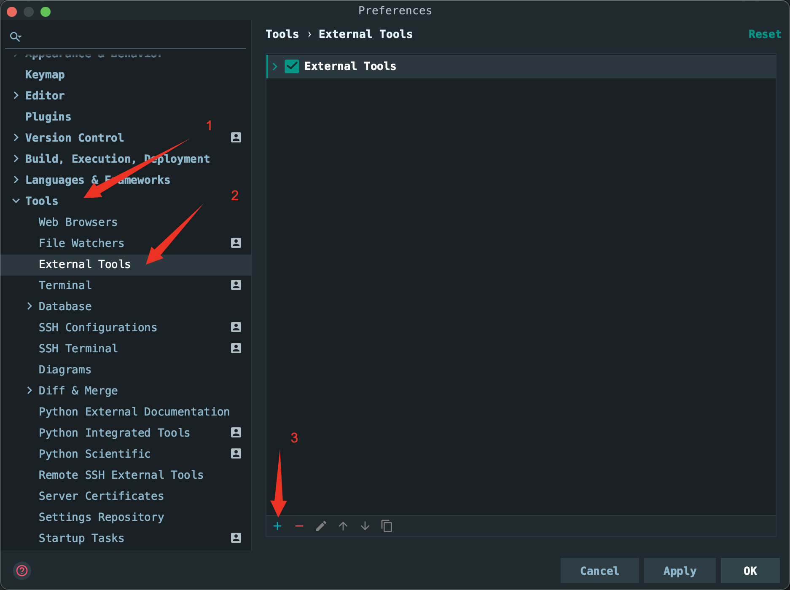
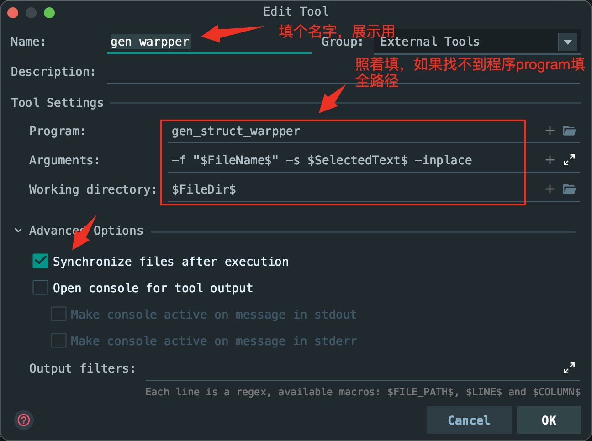
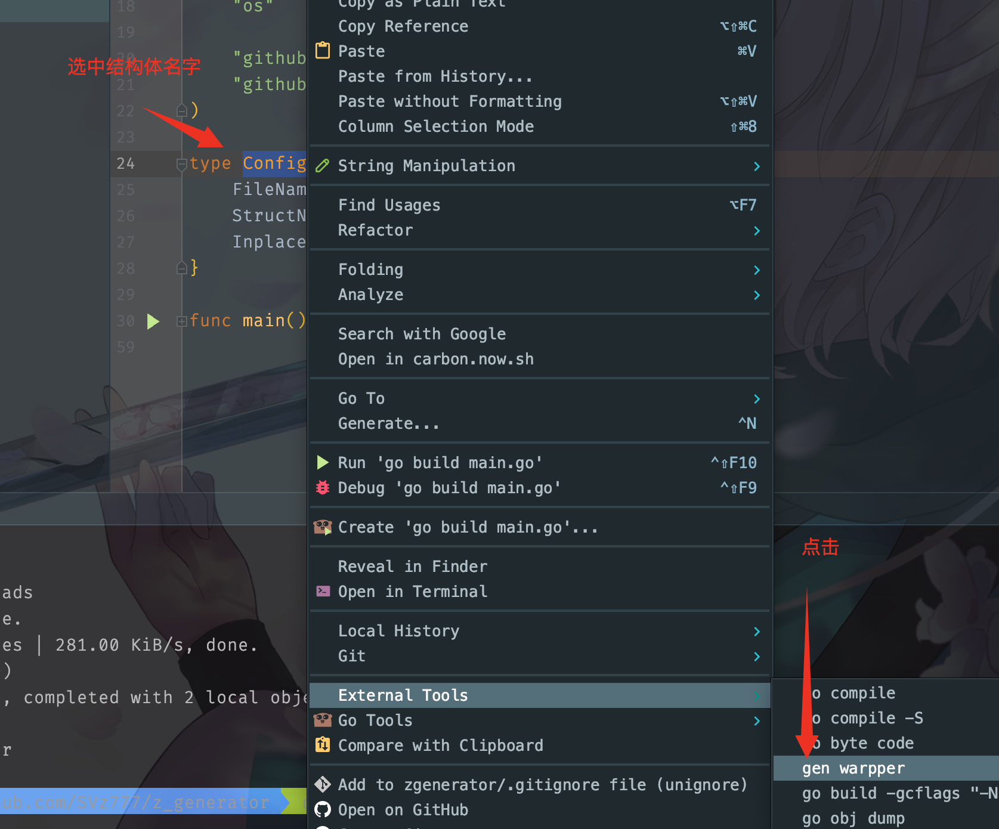

# 安装方法

git clone git@github.com:SVz777/z_generator.git

go install github.com/SVz777/z_generator.git/cmd/z_gen 这里会把二进制文件拷贝到${GOPATH}/bin下

到这就安装完成了，可以直接 z_gen 查看使用方法

# 配合idea使用




为了方便，我把配置放这
```
z_gen
-f "$FileName$" -s $SelectedText$ -inplace
$FileDir$
```



# 架构约定

```
cmd/z_gen     命令行入口
gen           框架层
  type.go       生成器注册表 + IGen 接口
  parser        源码 AST / 运行时反射 → 统一的 Struct 描述
  args          命令行参数解析（含多余参数收集）
  utils         模板函数与渲染
gen_impl      各生成器实现，一个目录一个
```

两条硬约定，新增生成器时请遵守：

**1. 生成器出错必须返回 error，不要把错误信息塞进返回值**

```go
func (g *Generator) Gen(v *parser.Struct) ([]byte, error)
```

返回值会被直接写进目标源文件。如果把 `err.Error()` 当代码返回，出错时会生成一个
不可编译的文件，且排查时看不到任何上下文。

**2. 模板用 `render.Render`，不要自己拼**

```go
func (g *Generator) Gen(v *parser.Struct) ([]byte, error) {
    return render.Render(GenType, tpl, g.getParams(v))  // //go:embed 进来的模板
}
```

`Render` 负责 解析模板 → 执行 → `format.Source` 三件事。格式化失败时错误里会附上
原始输出——生成的代码不合法时，只看 `expected xxx` 这种语法错误几乎无法定位。
生成非 Go 内容（Markdown、PHP 片段）时用 `render.Render` 不携带`render.WithFmt`，它跳过格式化。

模板请放在同目录的 `.tmpl` 文件里用 `//go:embed` 引入，不要内联在 Go 源码里。

模板里可用的辅助函数（`gen/utils`，全部只吃字符串形式的类型名）：

| 函数 | 作用 | 例子 |
|---|---|---|
| `canBeNil` | 该类型的值能否与 `nil` 比较 | `*int`→true，`int`/`[3]int`→false |
| `zeroOf` | 不能与 nil 比较时的零值字面量 | `int`→`0`，`string`→`""`，`T`→`T{}` |
| `isPtr` | 是否指针类型 | `*int`→true |
| `trimPtr` | 去掉一层前导 `*` | `*int`→`int` |
| `split` | 按分隔符切分 | `split "1,5" ","` |

写模板时凡是生成 `x.F == nil`，**必须先用 `canBeNil` 判断**：
数值、字符串、bool、数组、结构体与 nil 比较是编译错误，这类字段要用 `zeroOf` 判零值。
同理，生成 `x.F = &v` 的条件是字段本身为指针（`isPtr`），不是"值类型"。

### parser 包：直接沿用标准库 ast

源码解析的产物就是标准库的 `*ast.File`，本包不另造一棵 AST 树——需要的是"把结构体
描述提取出来"这一步，不是重新实现一遍 `go/ast`：

```go
// 一次解析，可以反复提取多个结构体
file, err := parser.ParseFile("req.go")
req, err  := parser.StructFrom(file, "Req")
resp, err := parser.StructFrom(file, "Resp")

// 只要一个结构体时的便捷写法
st, err := parser.StructFromFile("req.go", "Req")

// 运行时反射走同一套 Struct（通常传指针，否则拿不到指针接收者的方法）
st := parser.StructOf(&Req{})
```

辅助函数单独导出，写生成器时可以只取用其中一步，不必重复解析类型表达式：
`TypeName(ast.Expr)`、`ParamList([]*ast.Field)`、`FieldsOf(*ast.StructType, receiver)`、
`MethodOf(*ast.FuncDecl, recv)`、`TagOf(*ast.BasicLit)`。

结构体名写错时 `StructFrom` 返回 error，不会给一个空 `Struct` 让人继续生成出一堆空壳代码。

# validate 支持的校验规则

写在 struct tag 里，多条规则用 `|` 分隔（可用 `-validate_tag_sep` 改）：

```go
type User struct {
    Name  *string `validate:"required"`
    Age   int     `validate:"required|gte=18"`
    Level int     `validate:"range=1,5"`
    Title string  `validate:"required|min_len=2|max_len=32"`
}
```

| 规则 | 适用类型 | 说明 |
|---|---|---|
| `required` | 指针、string、数字、bool、slice、map、interface | 非零值。指针判断 `== nil`，slice/map 判断 `len() == 0` |
| `gt` `gte` `lt` `lte` | 数字（含指针） | 大于 / 大于等于 / 小于 / 小于等于，如 `gt=18` |
| `range` | 数字（含指针） | 闭区间，如 `range=1,5` 表示 1~5 都合法 |
| `len` `min_len` `max_len` | string、[]byte | 长度等于 / 至少 / 至多 |
| `child` | 任意 | 调用嵌套结构体的 `Validate()`，用 `%w` 包裹错误 |

规则名写错、类型不支持、参数缺失都会**让生成失败并报错**，不会降级成恒不触发的校验代码。
`required` 需要能判断零值才生效，自定义 struct 类型不支持（无法可靠判断零值），
这种字段请用指针 + `required`，或改用 `child`。

# 扩展参数（多余参数）

命令行上除了内置参数（`-f` `-s` `-tp` `-o` `-inplace`）以外，所有未声明的参数会被自动收集到
`args.Args.Extra` 这个 map 里，各 `gen_impl` 直接取用即可 —— 新增生成器时不用回来改 `args`。

```go
// gen_impl/xxx/xxx.go
import "github.com/SVz777/z_generator/gen/args"

func (g *Generator) getParams(v *parser.Struct) (*params, error) {
    return &params{
        Tag: args.Args.GetOr("validate_tag", "validate"), // 带默认值
        Sep: args.Args.GetOr("validate_tag_sep", "|"),
        Max: args.Args.GetInt("max", 10),
        All: args.Args.GetBool("all"),        // 不存在视为 false
        Get: args.Args.GetBoolOr("get", true), // 默认开启，可用 -get=false 关闭
        Sub: args.Args.Sub("php."),            // 取 php.xxx 前缀的参数子集
    }, nil
}

// 建议在 init 里声明。带上 GenType 后，-h 会按 -tp 过滤展示
args.Declare(GenType, "validate_tag", "校验用的 struct tag 名，默认 validate")
```

`Declare` 的第一个参数是生成器类型，决定这些参数在 `-h` 里何时出现：

```bash
z_gen -tp validate -h   # 只列出 validate 的扩展参数
z_gen -h                # 默认不展开，只提示哪些生成器有扩展参数
z_gen -tp php -h        # php 没声明过，不显示扩展参数节
```

`-h` 的位置不影响过滤：`z_gen -h -tp validate` 与 `z_gen -tp validate -h` 输出一致
（flag 包遇到 `-h` 就中断解析，所以 tp 是在正式解析前预扫描取的）。

### -tp 的可用类型

`-h` 里 `-tp` 会直接列出所有已注册的生成器类型，传了不存在的类型也会给出可用列表：

```
  -tp string
    	生成类型，可选:
    	doc, options, php, struct2map, struct_keys, struct_wrapper,
    	validate
```

类型列表来自 `gen.ListTypes()`，由主程序注入给 `args` 包：

```go
func main() {
    args.SetTypeLister(gen.ListTypes)   // 必须在 args.Args.Parse() 之前
    cfg := args.Args.Parse()
    ...
}
```

这样 `args` 包不必反向依赖生成器注册表。不注入也可以，只是 `-tp` 的帮助退化为"生成类型"。

支持四种写法，单双横线等价：

```bash
z_gen -f a.go -s Req -tp validate -validate_tag check -validate_tag_sep , -strict
#   => Extra{"validate_tag":"check", "validate_tag_sep":",", "strict":"true"}
```

几点已知行为（与标准 `flag` 包保持一致）：

- 未声明的参数无法推断类型，所以 `-k v` 中紧跟其后的非 flag 参数会被当作 `k` 的值；
  单独的 `-k` 记为 `"true"`。位置参数要放在多余参数之前，或用 `--` 分隔。
- 碰到第一个位置参数就停止解析，与 `flag` 包行为一致。
- `-h` / `-help` 仍由 `flag` 包处理，不会被收进 `Extra`。

> 没有引入 `pflag` / `go-flags` 等第三方库：实测它们对未知参数只能"容错丢弃"，
> 拿不到键值，且 `pflag` 的单横线短名会被误判吞掉，`go-flags` 只认 `--` 双横线，
> 与现有 CLI 写法不兼容。这里零依赖扫一遍 `os.Args` 即可，行为完全可控。